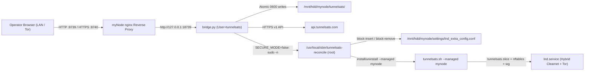

<p align="center">
  
</p>

<h3 align="center">Clearnet Lightning Over Encrypted VPN for myNode BTC</h3>

<p align="center">
  <a href="https://github.com/Tunnelsats/ts-mynode/actions/workflows/test.yml"></a>
  <a href="LICENSE"></a>
  
  <a href="https://tunnelsats.com/join-telegram"></a>
</p>

---

# TunnelSats for myNode BTC (`ts-mynode`)

Native TunnelSats application, **MyNode UI**, and Managed Dataplane integration for **myNode BTC** (App SDK v2, Debian 12+, LND).

TunnelSats provides dedicated WireGuard VPN tunnels with static port forwarding for Lightning Network nodes, allowing your myNode LND daemon (`lnd.service`) to route hybrid Clearnet + Tor traffic safely without exposing your residential IP address.

---

## Quick Install on myNode

Until the TunnelSats marketplace package is merged into the upstream `mynodebtc/mynode` App Store, you can install or update TunnelSats on any running myNode device in one step from your workstation:

```bash
git clone https://github.com/Tunnelsats/ts-mynode.git
cd ts-mynode
./scripts/deploy_mynode.sh <MYNODE_IP> admin
```

- **Open the MyNode UI**: Navigate to `https://mynode.local:8740` (or `http://<MYNODE_IP>:8739`), or open `https://mynode.local/app/tunnelsats/info` on your myNode dashboard.
- **Back up your config before uninstalling**: Use the **Backup .conf** button in the top header of the MyNode UI to download a copy of your `tunnelsatsv2.conf` (containing your WireGuard private key) before uninstalling or reflashing your device.
- **Uninstall**: Run `sudo mynode-manage-apps uninstall tunnelsats` on your myNode device (or click **Uninstall** on `/app/tunnelsats/info`).

---

## Key Features

- **In-App Server Discovery**: Browse live TunnelSats regional endpoints (`eu-de`, `eu-ch`, `us-east`, `us-west`, `ap-sg`, `ap-jp`, `sa-br`, `oc-au`) directly from the MyNode UI.
- **Lightning-Native Checkout & Lifecycle**:
  - Purchase new subscriptions (1, 3, 6, or 12 months) via BOLT11 Lightning invoices.
  - Automatic invoice settlement polling and `/subscription/claim` provisioning.
  - One-click subscription renewal (`POST /subscription/renew`) and $1 bandwidth top-ups (`POST /subscription/bandwidth-reset/create`).
- **NIP-47 NWC Auto-Renewal**: Connect a Nostr Wallet Connect (`nostr+walletconnect://`) wallet with per-duration budget caps and optional Tor SOCKS5h routing (`127.0.0.1:9050`) for unattended renewals within 7 days of expiry.
- **Local X25519 Key Custody & 1-Click Backup**: WireGuard private keys are generated locally on your myNode device (`0600` permissions in `/mnt/hdd/mynode/tunnelsats/`) and never transmitted to TunnelSats servers. Only the derived X25519 public key is sent during `/subscription/claim`. Export your `.conf` anytime via the **Backup .conf** button.
- **Fail-Closed Managed Dataplane (`tunnelsats.sh --managed mynode`)**:
  - Isolates `lnd.service` inside a dedicated cgroup v2 slice (`tunnelsats.slice`).
  - Enforces an independent `inet tunnelsats` nftables kill switch (`tunnelsats-killswitch.service`) that blocks clearnet leaks even when `wg-quick@tunnelsatsv2.service` is down or restarting.
  - Routes `tunnelsats.slice` packets via policy routing table `51820` while keeping SSH, nginx, and LAN management traffic untouched on the host default route.
  - Continuously audits kernel state and kill-switch attestation via `tunnelsats-verifier.timer`.
- **Safe Tor-Only Rollback**: Restoring or uninstalling removes the `# BEGIN TUNNELSATS` ... `# END TUNNELSATS` block from `/mnt/hdd/mynode/settings/lnd_extra_config.conf` before tearing down the managed dataplane, ensuring `mynode_gen_lnd_config.sh` regenerates a clean Tor-only `/mnt/hdd/mynode/lnd/lnd.conf` without disabling `lnd.service`.

---

## Architecture & Dual-Mode Privilege Separation



### 1. Mode A: Integrated 1-Click Mode (`SECURE_MODE=false`, default)

- The web controller (`bridge.py`) runs as the unprivileged `tunnelsats` Linux user bound strictly to `127.0.0.1:18739` behind myNode's nginx reverse proxy (`8739` HTTP / `8740` HTTPS).
- `/api/status` (with `/api/health` as a route alias) serves as the canonical health and operational telemetry endpoint (`200 OK` JSON status), while `/api/dashboard` returns the full MyNode UI read model.
- Validated WireGuard configurations (`tunnelsatsv2.conf`), subscription metadata (`tunnelsats-meta.json`), and NWC secrets (`nwc-wallet.json`) are stored in `/mnt/hdd/mynode/tunnelsats/` with `0600` permissions.
- When `pre_tunnelsats.sh` runs as root (`ExecStartPre=+`), it installs `/usr/local/sbin/tunnelsats-reconcile` (`root:root`, `0755`) and a tightly scoped `/etc/sudoers.d/tunnelsats-reconcile` rule permitting user `tunnelsats` to invoke only `/usr/local/sbin/tunnelsats-reconcile`.
- Applying a tunnel from the MyNode UI invokes `reconcile_mynode.sh apply`, which:
  1. Validates `/mnt/hdd/mynode/tunnelsats/tunnelsatsv2.conf` (`0600` permissions and strict WireGuard key/endpoint syntax).
  2. Atomically inserts/updates the `# BEGIN TUNNELSATS` ... `# END TUNNELSATS` block in `/mnt/hdd/mynode/settings/lnd_extra_config.conf`.
  3. Installs or refreshes `tunnelsats.sh install --managed mynode --impl "${TUNNELSATS_LN_IMPL:-lnd}"` (`tunnelsats.slice`, `tunnelsats-killswitch.service`, `wg-quick@tunnelsatsv2.service`, `tunnelsats-verifier.timer`) and restarts `lnd.service`.

### 2. Mode B: Secure Manual CLI Mode (`SECURE_MODE=true`)

- Operators who prefer zero privileged helper execution from the web service can enable `SECURE_MODE=true` via the MyNode UI toggle or `/mnt/hdd/mynode/tunnelsats/config.json` (`{"secure-mode": true}`).
- In Mode B, `reconcile_mynode.sh` refuses automated `apply`/`restore` actions and `pre_tunnelsats.sh` removes `/etc/sudoers.d/tunnelsats-reconcile`.
- The MyNode UI continues to handle server discovery, BOLT11 checkout, claim, renewal, bandwidth top-ups, NWC auto-renewal, `.conf` backup, and `.conf` staging at `/mnt/hdd/mynode/tunnelsats/tunnelsatsv2.conf`, while presenting exact copy-paste one-liner CLI commands for SSH execution:

```bash
# Apply TunnelSats managed dataplane and LND hybrid config over SSH (via reconciler):
sudo VPN_EXTERNAL_HOST=<vpn-server-host> VPN_PORT=<port> /opt/mynode/tunnelsats/scripts/reconcile_mynode.sh apply /mnt/hdd/mynode/tunnelsats/tunnelsatsv2.conf

# Or invoke tunnelsats.sh directly (pass --impl lnd to disambiguate when both lnd.service and lit.service exist on myNode):
sudo /opt/mynode/tunnelsats/scripts/tunnelsats.sh install --managed mynode --impl lnd --non-interactive --yes --config /mnt/hdd/mynode/tunnelsats/tunnelsatsv2.conf

# Verify live kernel dataplane and kill-switch attestation:
sudo /usr/local/sbin/tunnelsats verify --json

# Restore LND to Tor-only and remove managed dataplane:
sudo /opt/mynode/tunnelsats/scripts/reconcile_mynode.sh restore
```

---

## Upstream `mynodebtc/mynode` Marketplace Submission

1. Tag and release a new version in `Tunnelsats/ts-mynode` (e.g., `v1.0.0`).
2. Copy `mynode_app/tunnelsats/` to `rootfs/standard/usr/share/mynode_apps/tunnelsats/` in your `mynodebtc/mynode` fork and add `tunnelsats` to `MARKETPLACE_APPS` in `scripts/print_app_download_hashes.sh`.
3. Run `scripts/print_app_download_hashes.sh tunnelsats` in `mynodebtc/mynode` and update `download_source_sha256` in `tunnelsats.json`.
4. Verify with `./app_sdk/create.py check tunnelsats` and open a Pull Request to `mynodebtc/mynode`.

---

## License

Released under the [MIT License](LICENSE).

<sub>myNode is a trademark of MyNode LLC. TunnelSats is an independent integration built for myNode BTC.</sub>
